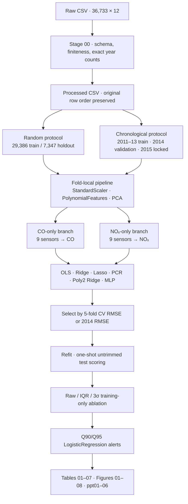
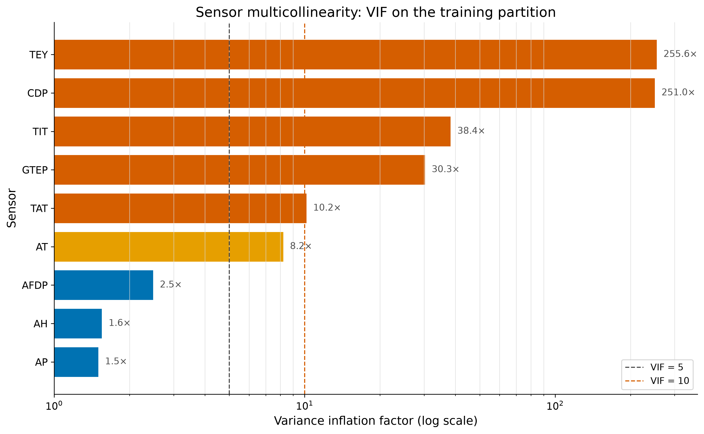
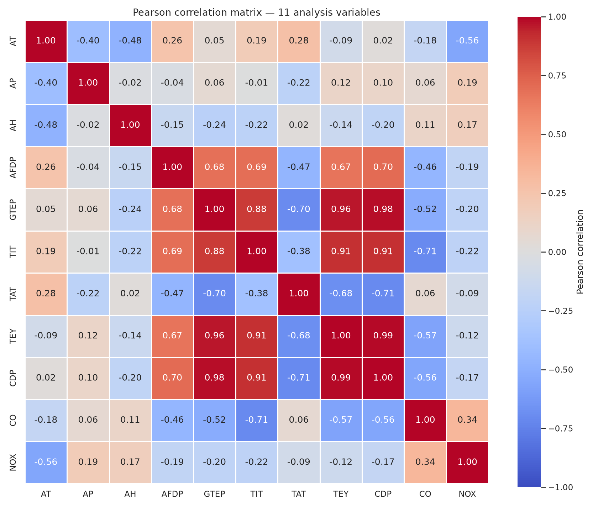
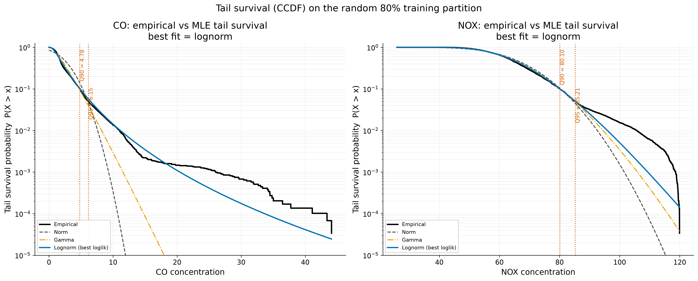
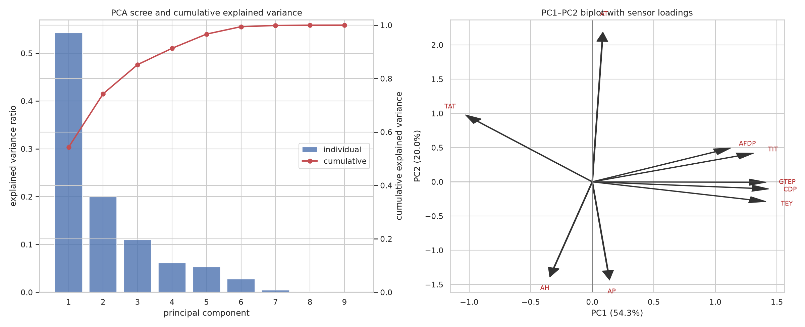
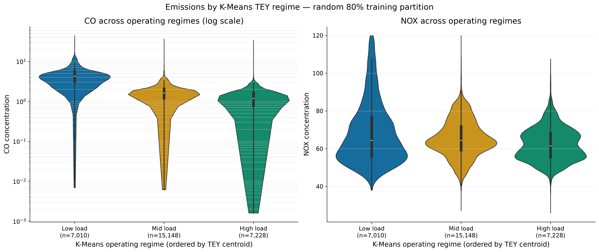
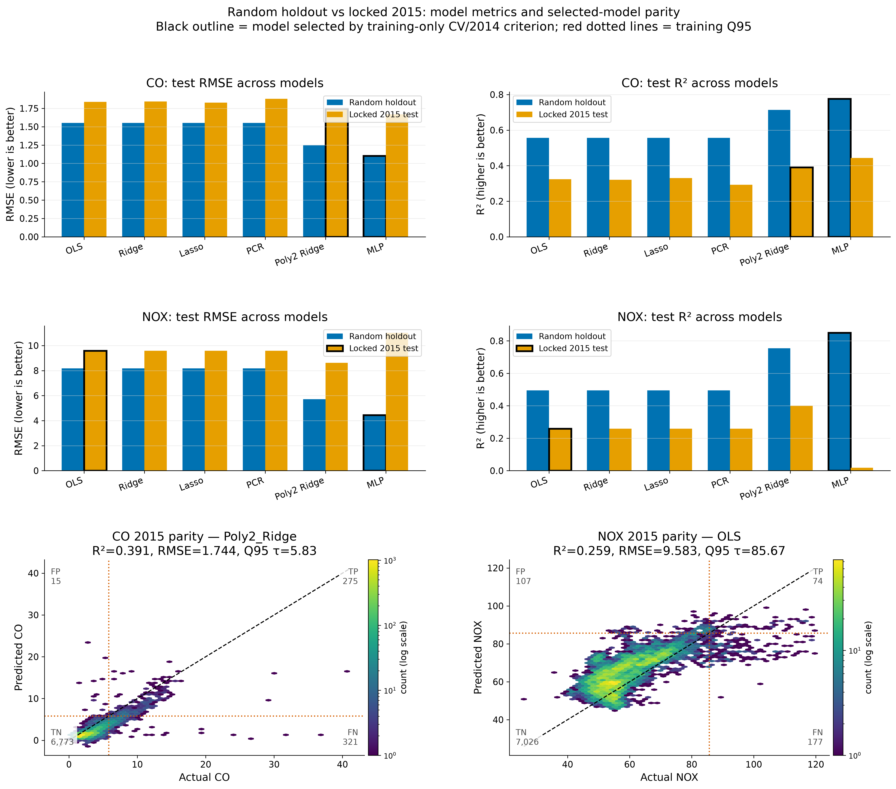
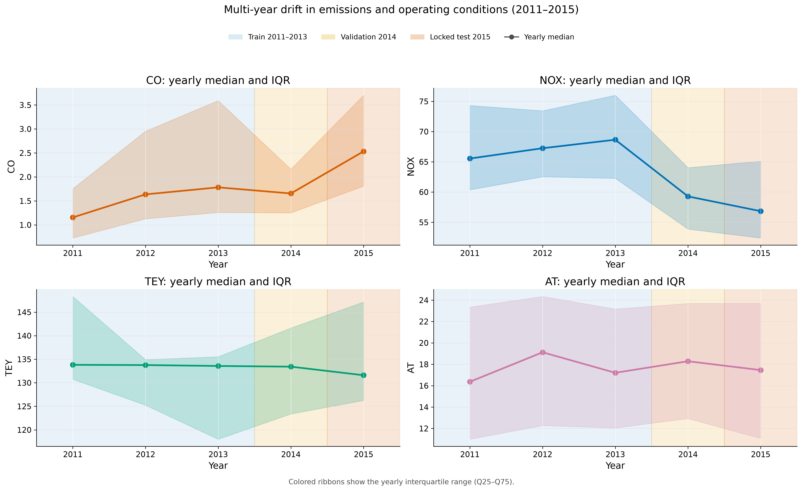
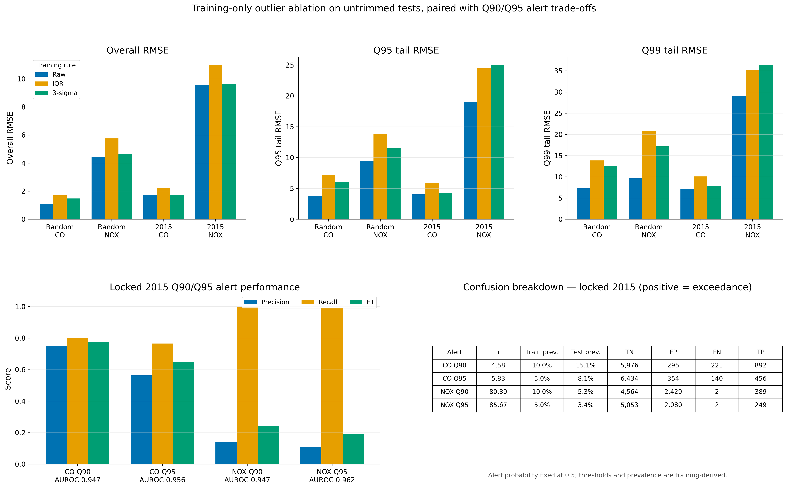
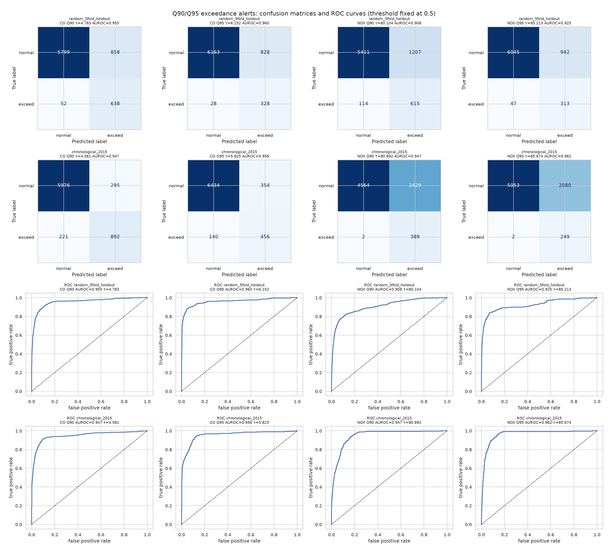

<div align="center">

<h1>Gas Turbine Predictive Emission Monitoring System (PEMS) for CO &amp; NOₓ</h1>

<h3>BITS Pilani, K. K. Birla Goa Campus — CHE F315: Machine Learning for Chemical Engineers</h3>

<p>
<a href="https://www.python.org/"></a>
<a href="https://scikit-learn.org/"></a>
<a href="https://archive.ics.uci.edu/dataset/551/gas+turbine+co+and+nox+emission+data+set"></a>
<a href="tests/verify_rubric.py"></a>
<a href="figures/ppt/"></a>
</p>

<p><strong>Sensor-only soft sensors for CO and NOₓ · 36,733 hourly observations · 2011–2015 · leakage-audited · reproducibility-first</strong></p>

</div>

---

<a id="toc"></a>

## Table of Contents

1. [Executive Summary & Headline Discoveries](#executive-summary)
2. [Dataset & Brayton-Cycle Physics](#dataset)
3. [System Architecture](#architecture)
4. [Visual Results Showcase](#visual-results)
5. [Complete Benchmark Tables](#benchmarks)
6. [CHE F315 Deliverable Mapping](#deliverables)
7. [Anti-Leakage & Syllabus Guardrails](#guardrails)
8. [Quickstart](#quickstart)
9. [Repository Structure](#structure)
10. [Reproducibility Checklist & Citation](#reproducibility)

---

<a id="executive-summary"></a>

## Executive Summary & Headline Discoveries

This repository implements a **Predictive Emission Monitoring System (PEMS)** that estimates carbon monoxide (**CO**) and nitrogen oxides (**NOₓ**) from nine gas-turbine sensors. The emissions targets are modeled **independently**: CO never enters a NOₓ feature matrix, and NOₓ never enters a CO feature matrix. `year` is split metadata only.

The project is deliberately evaluated twice:

| Protocol | Training / tuning | Final fit | Locked evaluation |
|---|---|---|---|
| `random_5fold_holdout` | 29,386 random rows; 5-fold CV on train only | 29,386 rows | **7,347 untrimmed holdout rows** |
| `chronological_2015` | 2011–2013 train = 22,191; 2014 validation = 7,158 | 2011–2014 = 29,349 rows, refit after selection | **7,384 untrimmed 2015 rows** |

<table>
<tr>
<td width="50%" valign="top">
<h3>🔥 1 · Nonlinear combustion kinetics</h3>
<p>The feed-forward MLP decisively beats OLS on random splits:</p>
<ul>
<li><strong>CO:</strong> R² <code>0.776</code> vs <code>0.557</code>; RMSE <code>1.103</code> vs <code>1.553</code></li>
<li><strong>NOₓ:</strong> R² <code>0.850</code> vs <code>0.495</code>; RMSE <code>4.452</code> vs <code>8.183</code></li>
</ul>
<p>Second-order polynomial ridge is already competitive, confirming genuine curvature/interactions rather than a purely linear sensor response.</p>
</td>
<td width="50%" valign="top">
<h3>⏳ 2 · Multi-year temporal drift</h3>
<p>Locking 2015 as an unseen future year exposes the optimism of random CV:</p>
<ul>
<li><strong>CO:</strong> R² <code>0.776 → 0.391</code>; RMSE <code>1.103 → 1.744</code> (<strong>+58.1%</strong>)</li>
<li><strong>NOₓ:</strong> R² <code>0.850 → 0.259</code>; RMSE <code>4.452 → 9.583</code> (<strong>+115.3%</strong>)</li>
</ul>
<p>CO yearly median rises from <code>1.156</code> (2011) to <code>2.533</code> (2015), while NOₓ falls from <code>65.542</code> to <code>56.838</code>.</p>
</td>
</tr>
<tr>
<td width="50%" valign="top">
<h3>⚠️ 3 · The outlier-handling paradox</h3>
<p>Training-only trimming is scored on <strong>identical untrimmed test rows</strong> (7,347 random / 7,384 chronological):</p>
<ul>
<li>IQR removes <strong>17.8–27.3%</strong> of training rows and worsens both global and tail RMSE.</li>
<li>Random CO: RMSE <code>1.103 → 1.695</code>; Q99 <code>7.273 → 13.874</code>.</li>
<li>Chronological NOₓ: RMSE <code>9.583 → 10.993</code>; Q99 <code>28.982 → 35.179</code>.</li>
</ul>
<p><strong>Raw, untrimmed training wins.</strong> Emissions spikes are signal, not noise to be deleted.</p>
</td>
<td width="50%" valign="top">
<h3>🚨 4 · Regulatory exceedance alerts</h3>
<p>Q90/Q95 logistic regression reaches <strong>AUROC <code>0.908–0.962</code></strong>:</p>
<ul>
<li>2015 CO Q90: precision <code>0.751</code>, recall <code>0.801</code>.</li>
<li>2015 NOₓ Q90: precision <code>0.138</code>, recall <code>0.995</code>; prevalence shifts <code>10.0% → 5.3%</code>.</li>
<li>2015 NOₓ Q95: precision <code>0.107</code>, recall <code>0.992</code>; prevalence shifts <code>5.0% → 3.4%</code>.</li>
</ul>
<p>High recall is achievable, but prevalence shift creates alert fatigue. This is a screening layer, not a certified CEMS replacement.</p>
</td>
</tr>
</table>

### At a Glance: Deployment-Facing Results

| Protocol | Target | Selected model | Test R² | Test RMSE | Q95 RMSE (n) | Q99 RMSE (n) |
|---|---|---|---:|---:|---:|---:|
| Random holdout | CO | **MLP** `(64,32), α=1e-4` | **0.776** | **1.103** | 3.796 (356) | 7.273 (75) |
| Random holdout | NOₓ | **MLP** `(64,32), α=1e-3` | **0.850** | **4.452** | 9.496 (360) | 9.638 (53) |
| Locked 2015 | CO | **Poly2 Ridge** `α=0.01` | **0.391** | **1.744** | 4.030 (596) | 7.061 (132) |
| Locked 2015 | NOₓ | **OLS** | **0.259** | **9.583** | 19.050 (251) | 28.982 (54) |

> **Key engineering message:** random CV is an interpolation estimate; the locked 2015 protocol is the deployment-facing estimate. Model, threshold, and trimming decisions are made **without** 2015 information.

---

<a id="dataset"></a>

## Dataset & Brayton-Cycle Physics

### Provenance and Verified Contract

- **Source:** [UCI Machine Learning Repository — Gas Turbine CO and NOₓ Emission Data Set (ID 551)](https://archive.ics.uci.edu/dataset/551/gas+turbine+co+and+nox+emission+data+set)
- **Scale:** **36,733 hourly observations × 12 columns** (year + 9 sensors + 2 targets)
- **Period:** 2011–2015
- **Missing values:** **0**
- **Rows removed:** **0**; duplicate rows and operational spikes are preserved
- **Seed:** `42` for every split, model, K-Means fit, and MLP initialization

| Year | Observations |
|---|---:|
| 2011 | 7,411 |
| 2012 | 7,628 |
| 2013 | 7,152 |
| 2014 | 7,158 |
| 2015 | 7,384 |
| **Total** | **36,733** |

### Full 11-Variable Specification

Statistics below are computed on the **29,386-row random training partition** (`table01`). VIF is reported only for the nine sensors; the targets are not predictors.

| Variable | Role | Physical interpretation | Train mean ± std | Train range | VIF |
|---|---|---|---:|---:|---:|
| `AT` | Ambient | Ambient temperature | 17.717 ± 7.429 | −6.235 → 35.822 | 8.249 |
| `AP` | Ambient | Ambient pressure | 1013.035 ± 6.438 | 986.250 → 1036.600 | 1.506 |
| `AH` | Ambient | Ambient humidity | 77.952 ± 14.428 | 25.987 → 100.200 | 1.557 |
| `AFDP` | Air path | Air-filter differential pressure | 3.926 ± 0.776 | 2.087 → 7.555 | 2.493 |
| `GTEP` | Exhaust | Gas-turbine exhaust pressure | 25.556 ± 4.198 | 17.698 → 40.716 | 30.349 |
| `TIT` | Combustion | Turbine inlet temperature | 1081.404 ± 17.555 | 1000.800 → 1100.900 | 38.430 |
| `TAT` | Exhaust | Turbine after-temperature | 546.160 ± 6.831 | 511.040 → 550.610 | 10.206 |
| `TEY` | Output | Turbine energy yield / load proxy | 133.479 ± 15.620 | 100.020 → 179.500 | 255.611 |
| `CDP` | Compression | Compressor discharge pressure | 12.059 ± 1.089 | 9.852 → 15.159 | 250.995 |
| `CO` | **Target** | Carbon monoxide concentration | 2.374 ± 2.245 | 0.0016 → 44.103 | — |
| `NOₓ` | **Target** | Nitrogen oxides concentration | 65.311 ± 11.720 | 25.905 → 119.910 | — |

> Sensor variables retain the UCI instrument scales in this table; every scaled pipeline receives fold-local `StandardScaler` inputs, while OLS remains the unscaled baseline. `year` is never a feature.

### Brayton-Cycle Interpretation

The nine sensors trace the thermodynamic chain of a gas turbine:

1. **Ambient boundary:** `AT`, `AP`, `AH` set inlet air density, humidity, and compressor workload.
2. **Air handling & compression:** `AFDP` captures filter/air-path resistance; `CDP` is the compressor discharge pressure and is a strong load/compression proxy.
3. **Combustion / hot section:** `TIT` is the turbine inlet temperature, the closest measured proxy for firing intensity.
4. **Expansion, exhaust & output:** `GTEP`, `TAT`, and `TEY` describe exhaust pressure, exhaust temperature, and useful energy yield.

**Why CO spikes at part load.** CO is a product of incomplete combustion. At low load, lower `TEY`, `TIT`, and `CDP` coincide with flame quenching and poorer oxidation. In the train partition, the median CO by regime is **4.262 → 1.604 → 1.180** from low → mid → high load.

**Why NOₓ is not a single load proxy.** Thermal NOₓ formation is strongly temperature-sensitive, but the empirical NOₓ medians across the three regimes are **64.311, 64.382, 61.440** — comparatively flat and slightly non-monotonic. Ambient conditions, air/fuel mixing, and nonlinear hot-section interactions matter; a multivariate model is required. This nuance is exactly why the project reports both global and tail metrics rather than assuming monotonic load behavior.

**Why multicollinearity is severe.** `TEY` (VIF **255.6**), `CDP` (**251.0**), `TIT` (**38.4**), `GTEP` (**30.3**), and `TAT` (**10.2**) are mechanically coupled. Six sensors exceed VIF = 5 and five exceed VIF = 10. Ridge, Lasso, and PCR are therefore scientifically appropriate diagnostics — but the near-identical OLS/PCR results later show that variance inflation alone does not explain the emissions challenge.

---

<a id="architecture"></a>

## System Architecture



```text
                    ┌──────────────────────────────┐
  9 sensors ────────┤  CO-only feature matrix X_CO │──► CO models  ──► CO forecasts / alerts
  (AT, AP, AH,      └──────────────────────────────┘
   AFDP, GTEP, TIT,  ┌──────────────────────────────┐
   TAT, TEY, CDP) ──┤ NOₓ-only matrix X_NOX        │──► NOₓ models ──► NOₓ forecasts / alerts
                    └──────────────────────────────┘
       NOₓ never enters X_CO          CO never enters X_NOX          year is never a predictor
```

### Syllabus-Strict Model Ladder

| Family | Exact estimator / pipeline | Search space |
|---|---|---|
| `OLS` | `LinearRegression()` | none |
| `Ridge` | `StandardScaler → Ridge(max_iter=20000)` | `α ∈ {1e-4, …, 100}` |
| `Lasso` | `StandardScaler → Lasso(max_iter=20000, random_state=42)` | same `α` grid |
| `PCR` | `StandardScaler → PCA → LinearRegression()` | 2–9 components |
| `Poly2_Ridge` | `PolynomialFeatures(degree=2, include_bias=False) → StandardScaler → Ridge` | same `α` grid |
| `MLP` | `StandardScaler → MLPRegressor(early_stopping=True, max_iter=1000, random_state=42)` | `(32,)` or `(64,32)`; `α ∈ {1e-4, 1e-3}` |
| `LogisticRegression` | `StandardScaler → LogisticRegression(C=1.0, class_weight="balanced", solver="lbfgs", max_iter=2000)` | fixed policy; alert probability 0.5 |
| Descriptive | `PCA`, `KMeans(k=3, n_init=20)`, `scipy.stats` MLE | train partition only |

**Not used anywhere:** SVM/SVR, tree ensembles, boosting, forests, KNN, Gaussian processes, density clustering/GMMs, deep-learning frameworks, or any other out-of-syllabus learner.

---

<a id="visual-results"></a>

## Visual Results Showcase

### 1 · Severe Brayton-Cycle Multicollinearity

<p align="center">
  
  
</p>

**Reading the evidence.** `TEY` VIF = **255.611**, `CDP` = **250.995**, `TIT` = **38.430**, `GTEP` = **30.349**, and `TAT` = **10.206**. The correlation heatmap shows the same mechanically coupled block. This is why the project tests ridge/PCR and reports VIF — not because regularization alone solves emissions prediction. The plain OLS/PCR results are nearly identical, proving the nonlinearity is in the combustion response, not merely in the sensor covariance.

### 2 · Parametric MLE: Lognormal Dominates Both Tails

<p align="center">
  
</p>

| Target | Distribution | Log-likelihood | AIC | BIC | Best by loglik |
|---|---|---:|---:|---:|:---:|
| CO | Normal | −65,461.489 | 130,926.978 | 130,943.554 | |
| CO | Gamma (`floc=0`) | −52,155.103 | 104,314.206 | 104,330.783 | |
| CO | **Lognormal (`floc=0`)** | **−51,513.910** | **103,031.820** | **103,048.396** | ✅ |
| NOₓ | Normal | −114,023.150 | 228,050.300 | 228,066.877 | |
| NOₓ | Gamma (`floc=0`) | −112,694.978 | 225,393.956 | 225,410.532 | |
| NOₓ | **Lognormal (`floc=0`)** | **−112,283.462** | **224,570.925** | **224,587.501** | ✅ |

The lognormal is decisively preferred for CO: **Δlog-likelihood = 13,947.579** and **ΔAIC = 17,895.158** versus the normal. For NOₓ, **Δlog-likelihood = 1,739.688**. Fitted lognormal parameters are `s = 0.793601, scale = 1.759879` (CO) and `s = 0.171696, scale = 64.333366` (NOₓ), both with `loc = 0`. The empirical CCDF falls far above the normal fit in the high-concentration tail — the statistical justification for Q95/Q99 metrics and for refusing to trim emissions spikes.

### 3 · PCA Modes and Three K-Means Load Regimes

<p align="center">
  
  
</p>

PCA on train-standardized sensors gives **54.28%** variance on PC1, **19.98%** on PC2 (cumulative **74.27%**), and **96.64%** across five components. PCR still chooses 9 components in the random protocol, so dimensionality reduction is not the limiting factor.

| Regime | n | TEY centroid | TIT centroid | CDP centroid | GTEP centroid | Median CO | Median NOₓ |
|---|---:|---:|---:|---:|---:|---:|---:|
| 0 · Low load | 7,010 | 112.398 | 1054.490 | 10.631 | 20.295 | **4.262** | 64.311 |
| 1 · Mid load | 15,148 | 133.073 | 1085.151 | 11.981 | 25.129 | 1.604 | 64.382 |
| 2 · High load | 7,228 | 154.783 | 1099.661 | 13.607 | 31.553 | **1.180** | 61.440 |

Total inertia is **124,978.1746**. The low-load regime carries roughly **3.6×** the median CO of the high-load regime, consistent with part-load quenching. NOₓ is comparatively flat across regimes (61.4–64.4 median), so its behavior requires more than a single load coordinate. K-Means labels are **descriptive only** and are never appended as regression predictors.

### 4 · Random CV vs Locked 2015, and Multi-Year Drift

<p align="center">
  
</p>

<p align="center">
  
</p>

The parity hexbins use the **chronology-selected** models (chosen on 2014 validation, not on 2015): Poly2 Ridge for CO and OLS for NOₓ. Q95 quadrant lines are training-derived (`τ_CO = 5.825`, `τ_NOₓ = 85.674`). CO has **15 FP / 275 TP / 6,773 TN / 321 FN**; NOₓ has **107 FP / 74 TP / 7,026 TN / 177 FN**. The 2015 clouds are visibly wider than the random holdout panels, and the yearly medians confirm real drift: CO **1.156 → 2.533**, NOₓ **65.542 → 56.838**, TEY **133.810 → 131.600**, AT **16.366 → 17.456**.

### 5 · Outlier Ablation and Regulatory Alert Trade-Offs

<p align="center">
  
</p>

<p align="center">
  
</p>

IQR trimming cuts training support by **17.8–27.3%** and consistently hurts both global and tail RMSE. The only overall improvement is a narrow chronological-CO 3σ result (RMSE **1.744 → 1.709**), but its Q95 and Q99 both worsen (**4.030 → 4.304**, **7.061 → 7.865**). The alert side tells the operational story: 2015 NOₓ Q90 catches **389 / 391** exceedances (recall **0.995**) at the cost of **2,429** false positives (precision **0.138**). High AUROC does not eliminate alert fatigue when prevalence shifts.

---

<a id="benchmarks"></a>

## Complete Benchmark Tables

### Table 04 — Random 5-Fold CV and Untrimmed Holdout

**Protocol:** 29,386 train / 7,347 test. Model and hyperparameters selected by minimum five-fold CV RMSE; holdout scored once. Values are R² and RMSE on the untrimmed holdout; tail columns show RMSE (n).

| Target | Model | Selected params | CV RMSE | CV R² | Test R² | Test RMSE | Q95 RMSE (n) | Q99 RMSE (n) |
|---|---|---|---:|---:|---:|---:|---:|---:|
| CO | OLS | — | 1.481 | 0.564 | 0.557 | 1.553 | 5.571 (356) | 11.161 (75) |
| CO | Ridge | α=1 | 1.481 | 0.564 | 0.557 | 1.553 | 5.572 (356) | 11.162 (75) |
| CO | Lasso | α=1e-4 | 1.481 | 0.564 | 0.557 | 1.553 | 5.572 (356) | 11.162 (75) |
| CO | PCR | 9 PCs | 1.481 | 0.564 | 0.557 | 1.553 | 5.571 (356) | 11.161 (75) |
| CO | Poly2_Ridge | α=1e-4 | 1.260 | 0.684 | 0.714 | 1.248 | 4.427 (356) | 8.576 (75) |
| CO | **MLP** | **(64,32), α=1e-4** | **1.138** | **0.743** | **0.776** | **1.103** | **3.796 (356)** | **7.273 (75)** |
| NOₓ | OLS | — | 8.094 | 0.523 | 0.495 | 8.183 | 20.993 (360) | 31.721 (53) |
| NOₓ | Ridge | α=0.1 | 8.094 | 0.523 | 0.495 | 8.183 | 20.994 (360) | 31.722 (53) |
| NOₓ | Lasso | α=1e-4 | 8.094 | 0.523 | 0.495 | 8.183 | 20.993 (360) | 31.722 (53) |
| NOₓ | PCR | 9 PCs | 8.094 | 0.523 | 0.495 | 8.183 | 20.993 (360) | 31.721 (53) |
| NOₓ | Poly2_Ridge | α=1e-4 | 5.710 | 0.762 | 0.754 | 5.708 | 12.839 (360) | 14.192 (53) |
| NOₓ | **MLP** | **(64,32), α=1e-3** | **4.743** | **0.836** | **0.850** | **4.452** | **9.496 (360)** | **9.638 (53)** |

### Table 05 — Chronological 2011–2014 → Locked 2015 Test

**Protocol:** 22,191 train (2011–2013) / 7,158 validation (2014); selected by 2014 RMSE, then refit on 29,349 rows (2011–2014). Values are on the untrimmed 2015 test (7,384 rows).

| Target | Model | Selected params | Val 2014 R² | Val 2014 RMSE | Test R² | Test RMSE | Q95 RMSE (n) | Q99 RMSE (n) |
|---|---|---|---:|---:|---:|---:|---:|---:|
| CO | OLS | — | 0.411 | 1.541 | 0.324 | 1.838 | 4.326 (596) | 8.273 (132) |
| CO | Ridge | α=100 | 0.467 | 1.465 | 0.320 | 1.843 | 4.371 (596) | 8.311 (132) |
| CO | Lasso | α=0.001 | 0.464 | 1.469 | 0.330 | 1.829 | 4.331 (596) | 8.281 (132) |
| CO | PCR | 7 PCs | 0.459 | 1.477 | 0.292 | 1.880 | 4.418 (596) | 8.343 (132) |
| CO | **Poly2_Ridge** | **α=0.01** | **0.551** | **1.344** | **0.391** | **1.744** | **4.030 (596)** | **7.061 (132)** |
| CO | MLP | (64,32), α=1e-4 | 0.511 | 1.404 | 0.443 | 1.668 | 4.057 (596) | 7.100 (132) |
| NOₓ | **OLS** | — | **0.265** | **8.550** | **0.259** | **9.583** | **19.050 (251)** | **28.982 (54)** |
| NOₓ | Ridge | α=1e-4 | 0.265 | 8.550 | 0.259 | 9.583 | 19.050 (251) | 28.982 (54) |
| NOₓ | Lasso | α=1e-4 | 0.264 | 8.557 | 0.259 | 9.584 | 19.052 (251) | 28.986 (54) |
| NOₓ | PCR | 9 PCs | 0.265 | 8.550 | 0.259 | 9.583 | 19.050 (251) | 28.982 (54) |
| NOₓ | Poly2_Ridge | α=0.1 | −0.028 | 10.111 | 0.401 | 8.618 | 11.001 (251) | 14.374 (54) |
| NOₓ | MLP | (64,32), α=1e-4 | −0.132 | 10.610 | 0.019 | 11.028 | 9.452 (251) | 11.614 (54) |

> **Selection honesty:** Poly2_Ridge and MLP have negative 2014 R² for NOₓ and are therefore rejected, even though Poly2_Ridge later achieves a better 2015 R² (0.401) than the selected OLS (0.259). Likewise, the CO MLP records the best 2015 test scores (R² 0.443, RMSE 1.668) but is **not** selected because 2014 validation chose Poly2_Ridge. No test-based substitution is made.

### Table 06 — Training-Only Outlier Ablation on Untrimmed Test Sets

| Protocol | Target | Model | Variant | Train retained / original | Test n | Test R² | Test RMSE | Q95 RMSE | Q99 RMSE |
|---|---|---|---:|---:|---:|---:|---:|---:|---:|
| Random 5-fold | CO | MLP | Raw | 29,386 / 29,386 | 7,347 | 0.776 | 1.103 | 3.796 | 7.273 |
| Random 5-fold | CO | MLP | IQR | 22,920 / 29,386 | 7,347 | 0.471 | 1.695 | 7.163 | 13.874 |
| Random 5-fold | CO | MLP | 3σ | 28,241 / 29,386 | 7,347 | 0.599 | 1.477 | 6.058 | 12.562 |
| Random 5-fold | NOₓ | MLP | Raw | 29,386 / 29,386 | 7,347 | 0.850 | 4.452 | 9.496 | 9.638 |
| Random 5-fold | NOₓ | MLP | IQR | 24,156 / 29,386 | 7,347 | 0.751 | 5.750 | 13.792 | 20.772 |
| Random 5-fold | NOₓ | MLP | 3σ | 28,279 / 29,386 | 7,347 | 0.836 | 4.667 | 11.479 | 17.173 |
| Chronological 2015 | CO | Poly2_Ridge | Raw | 29,349 / 29,349 | 7,384 | 0.391 | 1.744 | 4.030 | 7.061 |
| Chronological 2015 | CO | Poly2_Ridge | IQR | 21,333 / 29,349 | 7,384 | 0.023 | 2.209 | 5.856 | 10.070 |
| Chronological 2015 | CO | Poly2_Ridge | 3σ | 28,322 / 29,349 | 7,384 | 0.415 | 1.709 | 4.304 | 7.865 |
| Chronological 2015 | NOₓ | OLS | Raw | 29,349 / 29,349 | 7,384 | 0.259 | 9.583 | 19.050 | 28.982 |
| Chronological 2015 | NOₓ | OLS | IQR | 23,652 / 29,349 | 7,384 | 0.025 | 10.993 | 24.463 | 35.179 |
| Chronological 2015 | NOₓ | OLS | 3σ | 28,337 / 29,349 | 7,384 | 0.255 | 9.610 | 25.026 | 36.399 |

> **The test rows never change.** Every variant is scored on the same 7,347 random / 7,384 chronological rows with the same Raw-derived Q95/Q99 thresholds and tail counts.

### Table 07 — Q90/Q95 Logistic Exceedance Alerts

Positive class = exceedance (`y > τq`); alert probability fixed at **0.5**; confusion order is **TN / FP / FN / TP**.

| Protocol | Target | Q | τ | Train → test prevalence | Accuracy | Precision | Recall | F1 | AUROC | PR-AUC | TN / FP / FN / TP |
|---|---|---|---:|---|---:|---:|---:|---:|---:|---:|---|
| Random | CO | Q90 | 4.783 | 10.0% → 9.4% | 0.876 | 0.426 | 0.925 | 0.584 | 0.955 | 0.807 | 5,799 / 858 / 52 / 638 |
| Random | CO | Q95 | 6.152 | 5.0% → 4.8% | 0.883 | 0.284 | 0.921 | 0.434 | 0.960 | 0.799 | 6,163 / 828 / 28 / 328 |
| Random | NOₓ | Q90 | 80.104 | 10.0% → 9.9% | 0.820 | 0.338 | 0.844 | 0.482 | 0.908 | 0.690 | 5,411 / 1,207 / 114 / 615 |
| Random | NOₓ | Q95 | 85.213 | 5.0% → 4.9% | 0.865 | 0.249 | 0.869 | 0.388 | 0.925 | 0.687 | 6,045 / 942 / 47 / 313 |
| 2015 locked | CO | Q90 | 4.581 | 10.0% → 15.1% | 0.930 | 0.751 | 0.801 | 0.776 | 0.947 | 0.844 | 5,976 / 295 / 221 / 892 |
| 2015 locked | CO | Q95 | 5.825 | 5.0% → 8.1% | 0.933 | 0.563 | 0.765 | 0.649 | 0.956 | 0.779 | 6,434 / 354 / 140 / 456 |
| 2015 locked | NOₓ | Q90 | 80.892 | 10.0% → 5.3% | 0.671 | 0.138 | 0.995 | 0.242 | 0.947 | 0.585 | 4,564 / 2,429 / 2 / 389 |
| 2015 locked | NOₓ | Q95 | 85.674 | 5.0% → 3.4% | 0.718 | 0.107 | 0.992 | 0.193 | 0.962 | 0.505 | 5,053 / 2,080 / 2 / 249 |

### Supplementary Table 04b — `log1p(CO)` MLP Variant

| Protocol | Target | Model | Selection RMSE | Test R² | Test RMSE | Q95 RMSE | Q99 RMSE |
|---|---|---|---:|---:|---:|---:|---:|
| Random 5-fold | CO | MLP_log1p | 0.227 (log-space) | 0.766 | 1.129 | 4.154 | 7.986 |
| Chronological 2015 | CO | MLP_log1p | 0.342 (log-space) | 0.355 | 1.795 | 4.389 | 7.260 |

The log-target variant does not beat the raw-target MLP on the random holdout (**1.129 vs 1.103**) or the chronology-selected Poly2 Ridge (**1.795 vs 1.744**), so raw-target models remain primary. It is retained as a transparency check, not a cherry-picked result.

---

<a id="deliverables"></a>

## CHE F315 Deliverable Mapping

The executed notebook contains **22 cells, 7 code cells, execution counts 1–7, and zero error outputs**.

| Notebook Section | Prof. Riju De Deliverable | What Is Executed / Presented | Primary Artifacts |
|---|---|---|---|
| **1** | Problem statement & data contract | Stage 00, schema, exact year counts, target isolation, both split timelines | `data/processed/gas_turbine_modeling.csv` |
| **2** | EDA, outliers, VIF | Stage 01; univariate KDE/boxplots, 11×11 Pearson heatmap, VIF, slide-ready VIF chart | `table01`, `fig01`, `fig02`, `ppt01` |
| **3** | Distribution MLE | `norm`/`gamma`/`lognorm` fits, loglik/AIC/BIC, CCDF tail survival | `table02`, `fig03`, `ppt02` |
| **4** | PCA & K-Means regimes | Train-only PCA, 3-regime K-Means, centroid summaries, regime emissions | `table03`, `fig04`, `fig05`, `ppt03` |
| **5** | Regression CV vs chronology | OLS→Ridge→Lasso→PCR→Poly2→MLP, 5-fold CV, locked 2015, parity | `table04`, `table05`, `fig06`, `ppt05` |
| **6** | Outlier ablation & drift | Raw/IQR/3σ on identical untrimmed tests, multi-year drift ribbons | `table06`, `fig07`, `ppt04` |
| **7** | Q90/Q95 alerts & conclusions | Logistic exceedance classifiers, ROC/confusion, ablation+alert synthesis | `table07`, `fig08`, `ppt06` |

The notebook is reproducible from top to bottom and displays every saved artifact inline. Markdown takeaways accompany each 300-DPI slide figure.

---

<a id="guardrails"></a>

## Anti-Leakage & Syllabus Guardrails

`tests/verify_rubric.py` is the executable contract. It is **not weakened or edited** to accommodate results.

| Risk | Enforcement |
|---|---|
| Out-of-syllabus algorithms | AST scan across every `src/*.py` and every notebook code cell; banned imports/symbols fail even if dead code |
| CO ↔ NOₓ leakage | `X = df[SENSORS]` for every model; opposite target excluded from features, unions, and preprocessing |
| Preprocessing leakage | `StandardScaler`, `PolynomialFeatures`, PCA, K-Means, MLE, trimming limits, and thresholds fit inside the relevant training fold/partition |
| Temporal leakage | 2011–2013 train → 2014 validation → 2015 locked test; 2015 never participates in model, feature, threshold, or trimming decisions |
| Selection leakage | Random models chosen by 5-fold CV RMSE; chronological models chosen by 2014 RMSE; never by holdout/2015 performance |
| Trimming leakage | IQR/3σ limits learned on training rows only; validation/test rows are never trimmed |
| Tail-threshold leakage | Q90/Q95/Q99 thresholds come from training targets only; strict `y > τ` membership |
| Reproducibility | Seed `42`; deterministic split indices; saved JSON hyperparameters; fixed output schemas |

**Banned modules (exact):**

```text
xgboost, lightgbm, catboost, shap, imblearn, torch, tensorflow, keras
```

**Banned algorithm families:** SVM/SVR variants, random forests, extra trees, gradient boosting, decision trees, KNN, Gaussian processes, density clustering, Gaussian mixtures, and deep sequence/convolution layers. See [`tests/verify_rubric.py`](tests/verify_rubric.py) for the authoritative AST sets.

<details>
<summary><strong>Exact banned symbol set (AST-enforced)</strong></summary>

```text
SVC, SVR, NuSVC, NuSVR, LinearSVC, LinearSVR
RandomForestRegressor, RandomForestClassifier
ExtraTreesRegressor, ExtraTreesClassifier
GradientBoostingRegressor, GradientBoostingClassifier
HistGradientBoostingRegressor, HistGradientBoostingClassifier
DecisionTreeRegressor, DecisionTreeClassifier
KNeighborsRegressor, KNeighborsClassifier
GaussianProcessRegressor, GaussianProcessClassifier
DBSCAN, OPTICS, HDBSCAN, GaussianMixture, BayesianGaussianMixture
LSTM, GRU, Conv1d, Conv2d
```

</details>

**Four final rubric checks:**

1. Strict syllabus compliance in `src/`.
2. Required tables and figures integrity.
3. Chronological drift and model-sanity columns.
4. Executed notebook validity and syllabus cleanliness.

```text
$ .venv/bin/pytest -v tests/verify_rubric.py
4 passed

$ .venv/bin/ruff check src tests
All checks passed!
```

---

<a id="quickstart"></a>

## Quickstart

```bash
# 1 · Clone and enter the repository
git clone git@github.com:Samar-Talwar/CHE-F315-gas-turbine-pems.git
cd CHE-F315-gas-turbine-pems

# 2 · Create the Python 3.12 environment
python3.12 -m venv .venv
source .venv/bin/activate
python -m pip install --upgrade pip
python -m pip install numpy pandas scipy scikit-learn matplotlib seaborn jupyter pytest ruff

# 3 · Execute the five analysis/reporting stages
python src/00_load_data.py
python src/01_eda_outliers_mle.py
python src/02_pca_kmeans.py
python src/03_train_regression_cv.py
python src/04_logistic_and_parity.py
python src/05_ppt_figures.py

# 4 · Execute the presentation notebook top-to-bottom
python -m jupyter nbconvert --to notebook --execute --inplace \
  notebooks/CHE_F315_Gas_Turbine_PEMS.ipynb

# 5 · Run the acceptance gates
python -m pytest -v tests/verify_rubric.py
python -m ruff check src tests
```

> `src/03_train_regression_cv.py` is the long-running stage: it performs five-fold and chronological MLP fits. On a typical laptop the notebook takes several minutes; the `--ExecutePreprocessor.timeout=7200` option may be added if the default cell timeout is tight.

### Pinned Environment Used Here

```text
Python 3.12.3 · numpy 2.5.5 · pandas 3.1.1 · scipy 1.18.1
scikit-learn 1.9.1 · matplotlib 3.11.2 · seaborn 0.13.2
jupyter/nbconvert 7.17.2 · pytest 9.2.0 · ruff 0.17.6
```

---

<a id="structure"></a>

## Repository Structure

```text
.
├── AGENTS.md                         # Verified data contract + non-negotiable rules
├── PROJECT_SPEC.md                   # Executable stage + notebook specification
├── RESULTS_SYNTHESIS.md              # Narrative results synthesis (7 deliverables)
├── README.md                         # This document
├── pytest.ini                        # Makes verify_rubric.py collectable
├── .gitignore
│
├── data/
│   ├── raw/
│   │   └── gas_turbine_full.csv      # 36,733 × 12 verified input
│   └── processed/
│       └── gas_turbine_modeling.csv  # Validated, row-order-preserving copy
│
├── src/
│   ├── pems_common.py                # Constants, splits, metrics, threshold helpers
│   ├── 00_load_data.py               # Stage 00 · schema/year/finite validation
│   ├── 01_eda_outliers_mle.py         # Stage 01 · EDA, VIF, MLE
│   ├── 02_pca_kmeans.py              # Stage 02 · PCA, K-Means regimes
│   ├── 03_train_regression_cv.py     # Stage 03 · CV, chronology, ablation
│   ├── 04_logistic_and_parity.py     # Stage 04 · Q90/Q95 alerts
│   └── 05_ppt_figures.py             # Stage 05 · 300-DPI slide figures
│
├── results/
│   ├── table01_eda_outliers_vif.csv
│   ├── table02_mle_loglik.csv
│   ├── table03_kmeans_centroids.csv
│   ├── table04_regression_5fold_cv.csv
│   ├── table04b_log1p_co_variant.csv
│   ├── table05_regression_chronological_2015.csv
│   ├── table06_outlier_ablation_untrimmed_test.csv
│   └── table07_logistic_exceedance_metrics.csv
│
├── figures/
│   ├── fig01_univariate_kde_boxplots.png
│   ├── fig02_correlation_heatmap_11x11.png
│   ├── fig03_mle_distribution_fits.png
│   ├── fig04_pca_scree_biplot.png
│   ├── fig05_kmeans_regimes.png
│   ├── fig06_parity_cv_vs_chronological.png
│   ├── fig07_outlier_ablation_tails.png
│   ├── fig08_logistic_confusion_roc.png
│   └── ppt/
│       ├── ppt01_sensor_vif_log.png
│       ├── ppt02_mle_tail_survival.png
│       ├── ppt03_regime_emissions.png
│       ├── ppt04_multiyear_drift_2011_2015.png
│       ├── ppt05_cv_vs_2015_parity.png
│       └── ppt06_ablation_and_alerts.png
│
├── notebooks/
│   └── CHE_F315_Gas_Turbine_PEMS.ipynb   # Executed, 7-code-cell presentation
│
└── tests/
    └── verify_rubric.py              # 4/4 AST + artifact + notebook checks
```

---

<a id="reproducibility"></a>

## Reproducibility Checklist & Citation

- [x] Exact **36,733 × 12** data contract; row order and duplicates preserved
- [x] **0** missing values; no imputation or row deletion
- [x] CO and NOₓ targets modeled independently
- [x] `year` never used as a predictor
- [x] 2015 locked and scored once per protocol
- [x] Every transform refit within its training fold/partition
- [x] Tail thresholds derived from training targets only
- [x] Raw/IQR/3σ ablation scored on identical untrimmed test rows
- [x] Seed **42** everywhere
- [x] **4/4** rubric tests pass; `ruff check src tests` clean
- [x] Executed notebook with counts **1–7** and no error outputs
- [x] All six slide figures exported at **300 DPI**

### Data Citation

> UCI Machine Learning Repository. *Gas Turbine CO and NOₓ Emission Data Set* (ID 551).
> [https://archive.ics.uci.edu/dataset/551/gas+turbine+co+and+nox+emission+data+set](https://archive.ics.uci.edu/dataset/551/gas+turbine+co+and+nox+emission+data+set)

### Course

> **CHE F315 — Machine Learning for Chemical Engineers**
> BITS Pilani, K. K. Birla Goa Campus


