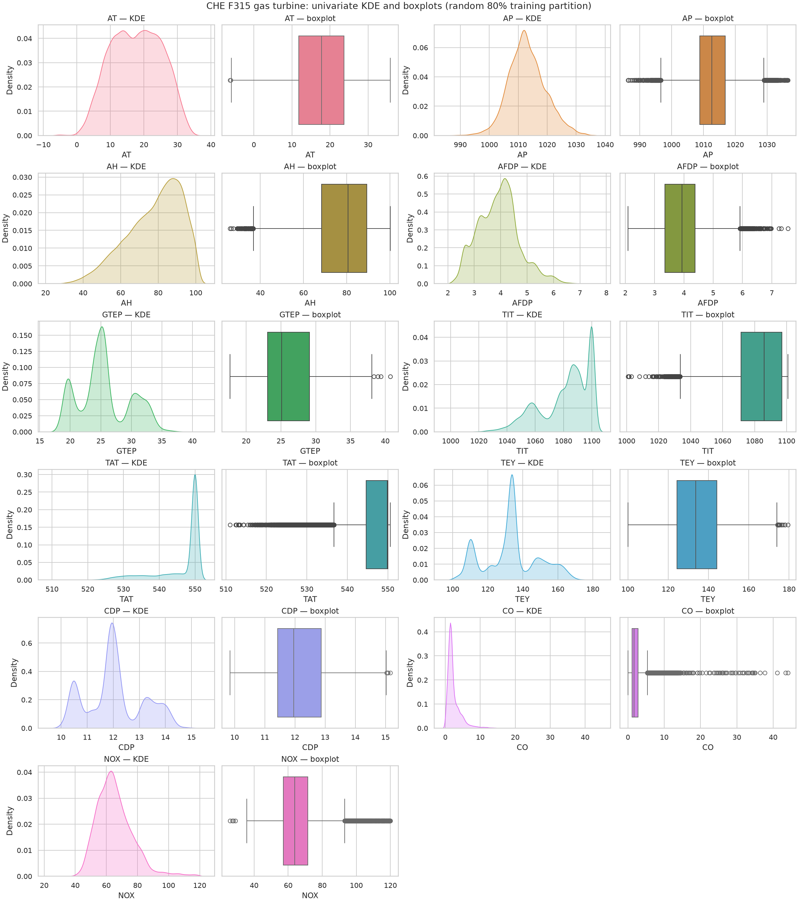
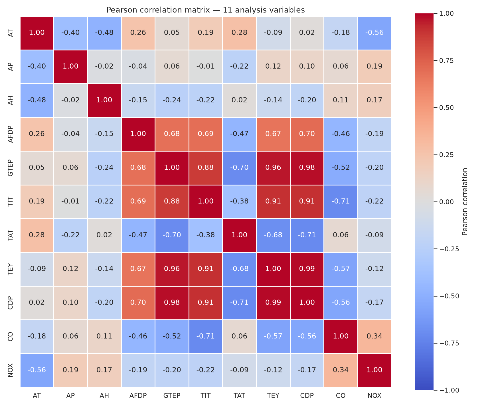
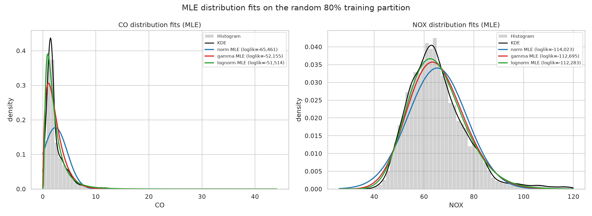
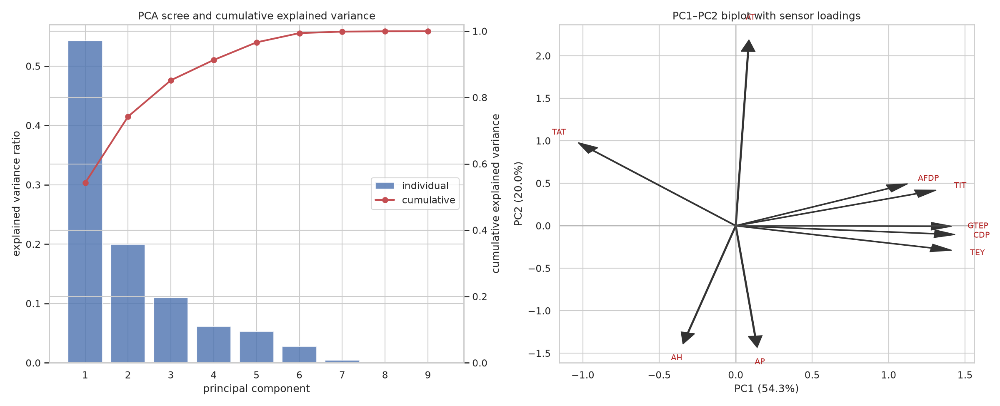
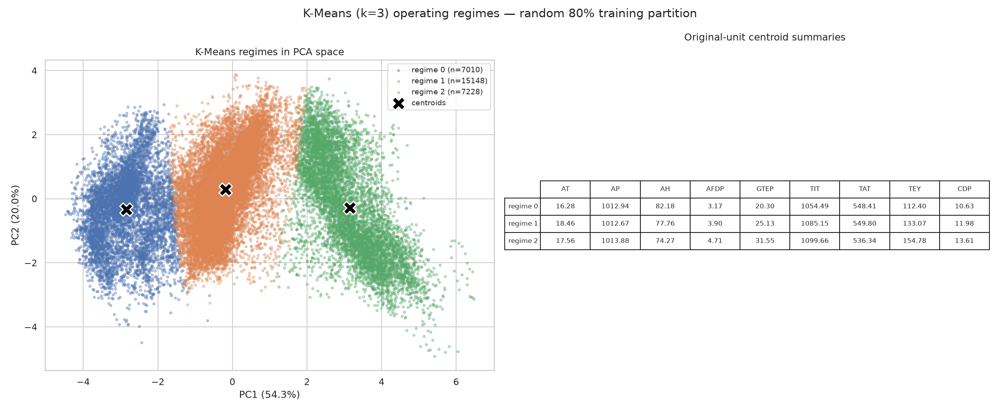
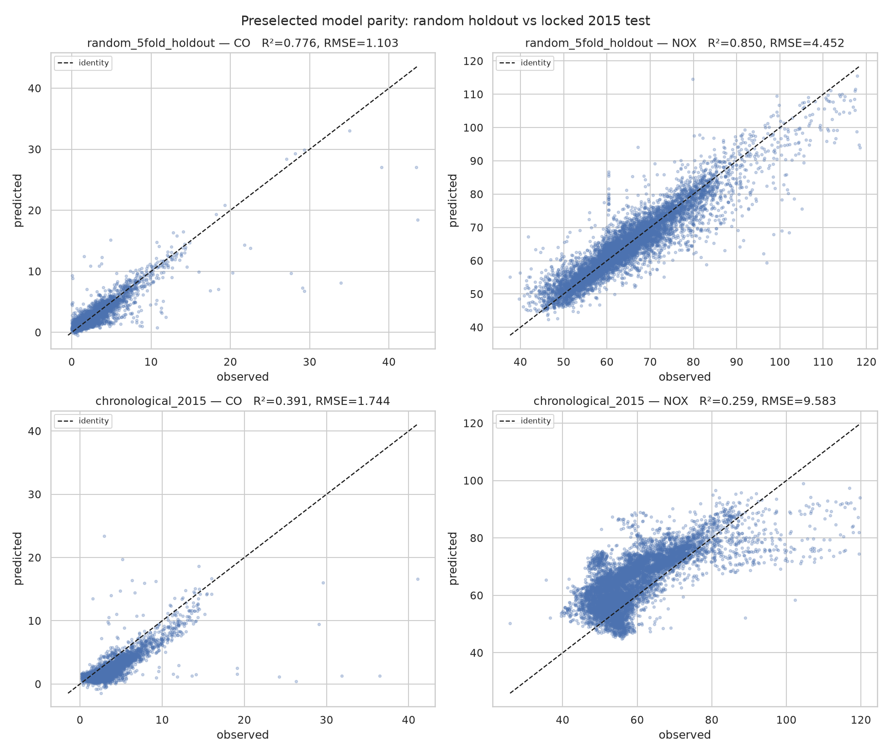
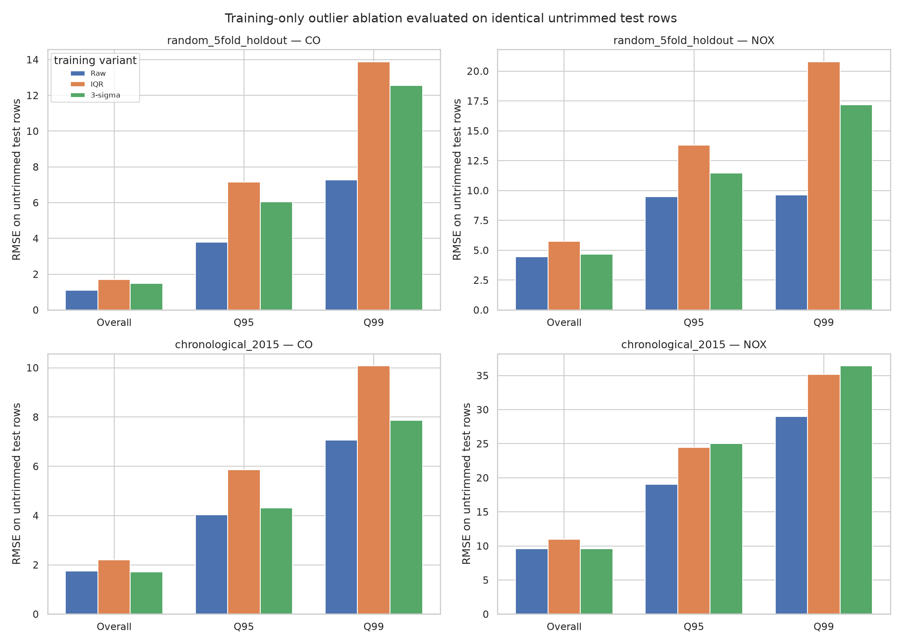
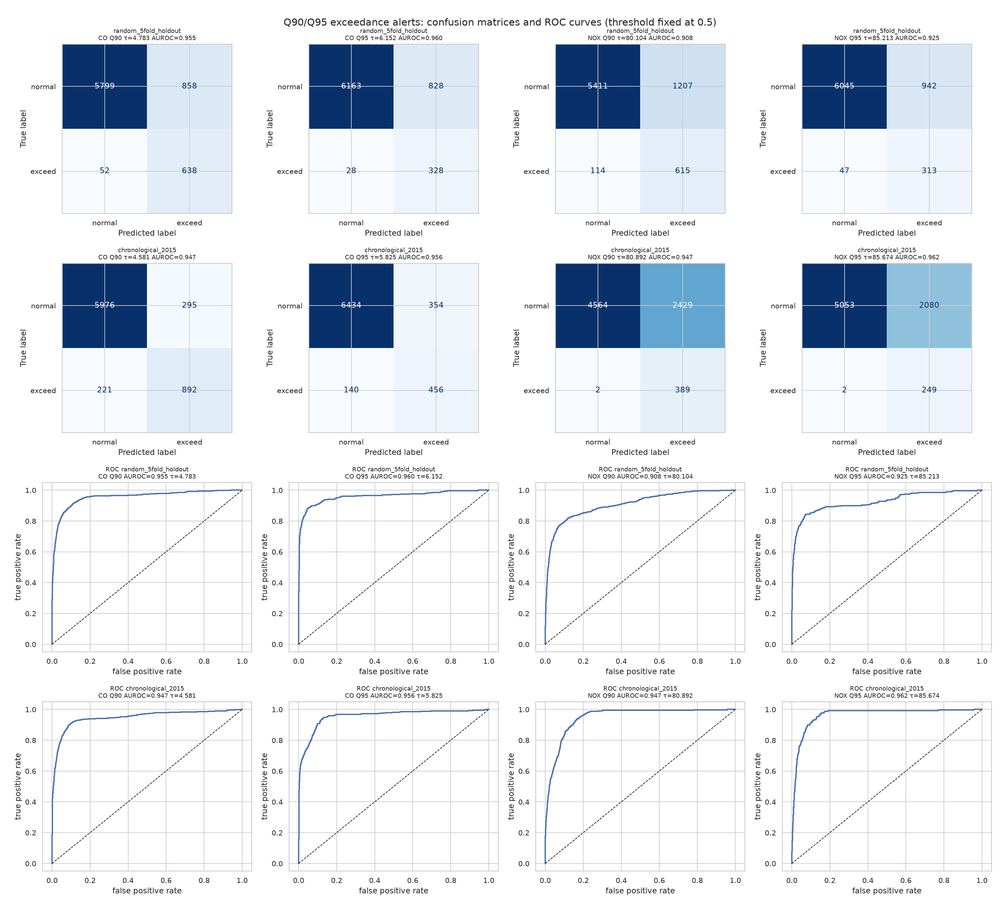

# CHE F315 Gas Turbine PEMS — Results Synthesis

**Course:** CHE F315, BITS Goa · **Presentation deliverables:** Prof. Riju De · **Reproducibility:** seed 42 throughout

All numbers below are taken directly from `results/*.csv`; every figure is reproduced in `figures/` and displayed in the executed notebook `notebooks/CHE_F315_Gas_Turbine_PEMS.ipynb`.

---

## 1. Problem Statement & ML Motivation

**Goal.** Build a predictive emissions monitoring system (PEMS) that estimates **CO** and **NOX** from nine gas-turbine sensor channels — `AT, AP, AH, AFDP, GTEP, TIT, TAT, TEY, CDP` — and raises exceedance alerts without using the other emissions target as an input. A sensor-only soft sensor is valuable as a screening layer when hardware CEMS measurements are delayed, unavailable, or need independent cross-checking.

**Data contract (verified).** `data/raw/gas_turbine_full.csv` contains **36,733 rows × 12 columns** in the exact order `year, AT, AP, AH, AFDP, GTEP, TIT, TAT, TEY, CDP, CO, NOX`, with **zero missing values** and no imputation, deduplication, or row deletion. Year counts are **2011 = 7,411; 2012 = 7,628; 2013 = 7,152; 2014 = 7,158; 2015 = 7,384**. `year` is split metadata, never a predictor.

**Two deliberately different evaluations.**

| Protocol | Training / tuning | Final fit | Locked evaluation |
|---|---|---|---|
| `random_5fold_holdout` | 29,386 random 80% rows; five-fold CV on those rows only | 29,386 rows | 7,347 untrimmed holdout rows |
| `chronological_2015` | 2011–2013 = 22,191 train; 2014 = 7,158 validation | 2011–2014 = 29,349 rows, refit **after** 2014 selection | 2015 = 7,384 untrimmed rows |

**Why machine learning.** Emissions depend nonlinearly on load, ambient conditions, and turbine state; high sensor collinearity makes naïve OLS unstable; and the operational question is not only average error but performance during rare high-emission tails and on a future year.

**Non-negotiable leakage controls.** CO and NOX are modeled independently with only the nine sensors; every scaler, polynomial expansion, PCA, K-Means fit, MLE fit, outlier limit, and quantile threshold is fitted on the relevant training fold/partition; no model, hyperparameter, threshold, or trimming rule is chosen using the holdout or 2015; and every test set remains untrimmed.

---

## 2. EDA & Outlier/VIF/MLE Diagnostics

### 2.1 Univariate behavior and outliers (Table 01, Figure 01)

The descriptive fits use only the **29,386-row random training partition**.

| Variable | Mean | Std (ddof=1) | Median | Q99 | Max | IQR outliers | 3σ outliers |
|---|---:|---:|---:|---:|---:|---:|---:|
| CO | 2.373896 | 2.245034 | 1.713950 | 11.004050 | 44.103000 | 2,136 | 532 |
| NOX | 65.311030 | 11.719623 | 63.844000 | 105.654500 | 119.910000 | 770 | 447 |
| AT | 17.716960 | 7.429408 | 17.823000 | 32.163150 | 35.822000 | 2 | 18 |
| AP | 1013.034611 | 6.437833 | 1012.600000 | 1029.300000 | 1036.600000 | 513 | 167 |
| TAT | 546.159630 | 6.830996 | 549.880000 | 550.040000 | 550.610000 | 3,934 | 329 |
| TEY | 133.479425 | 15.620379 | 133.730000 | 166.373000 | 179.500000 | 20 | 0 |

CO is strongly right-skewed: its mean (2.373896) exceeds its median (1.713950), and its maximum (44.103) is roughly four times Q99 (11.00405). The IQR fence is `[-1.31475, 5.34545]`, so the negative lower fence is not physically meaningful and the upper tail dominates. NOX is also right-tailed but much less extremely. TAT's 3,934 IQR outliers reflect its narrow, quantized upper operating band (Q75 = 549.88, max = 550.61), not a data-cleaning license.

**Engineering implication:** emissions spikes are genuine tail behavior to be modeled and evaluated, not noise to be deleted.

### 2.2 Collinearity and correlation structure (Table 01, Figure 02)

Sensor VIF, computed by OLS of each sensor on the other eight, is dominated by the mechanical load/pressure block:

| Sensor | VIF | Sensor | VIF |
|---|---:|---|---:|
| TEY | 255.610822 | TAT | 10.206208 |
| CDP | 250.995163 | AT | 8.248592 |
| TIT | 38.429868 | AFDP | 2.493433 |
| GTEP | 30.349381 | AP / AH | 1.505939 / 1.557025 |

VIF is intentionally blank for CO and NOX because they are targets, not predictors. The annotated 11 × 11 Pearson heatmap (fixed `ANALYSIS` order, scale [-1, 1]) shows the same dense dependence among GTEP/TIT/TAT/TEY/CDP. This justifies PCR and ridge as diagnostics, while the near-unity OLS/PCR results later show that collinearity alone does not explain the nonlinear emissions signal.

### 2.3 MLE distribution diagnostics (Table 02, Figure 03)

Normal, gamma (`floc=0`), and lognormal (`floc=0`) densities were fitted independently to each target by MLE. Selection is by **maximum log-likelihood**, with AIC/BIC as diagnostics.

| Target | Distribution | Log-likelihood | AIC | BIC | Best |
|---|---|---:|---:|---:|:---:|
| CO | Normal | -65,461.488824 | 130,926.977647 | 130,943.554194 | |
| CO | Gamma | -52,155.103235 | 104,314.206470 | 104,330.783017 | |
| CO | **Lognormal** | **-51,513.909858** | **103,031.819716** | **103,048.396263** | ✓ |
| NOX | Normal | -114,023.150101 | 228,050.300202 | 228,066.876749 | |
| NOX | Gamma | -112,694.977955 | 225,393.955910 | 225,410.532458 | |
| NOX | **Lognormal** | **-112,283.462260** | **224,570.924520** | **224,587.501067** | ✓ |

The lognormal parameters are `s = 0.793601, scale = 1.759879` for CO and `s = 0.171696, scale = 64.333366` for NOX (`loc = 0`). The normal is decisively rejected for CO (Δlog-likelihood ≈ 13,947.58 versus lognormal), confirming that symmetric residual assumptions are inappropriate. This motivates tail-specific Q95/Q99 reporting and the supplementary `log1p(CO)` MLP check rather than target trimming.

---

## 3. Inputs/Outputs & PCA/K-Means Regimes

**Inputs and outputs.** Every regression and classifier receives exactly the same nine standardized sensor inputs. CO models never see NOX; NOX models never see CO; neither sees `year`. The two targets are separate outputs, not a joint feature union.

### 3.1 PCA structure (Figure 04)

Full PCA on train-standardized sensors gives:

| Component | PC1 | PC2 | PC3 | PC4 | PC5 | PC6 |
|---|---:|---:|---:|---:|---:|---:|
| Explained variance | 54.28% | 19.98% | 10.94% | 6.12% | 5.31% | 2.78% |
| Cumulative | 54.28% | 74.27% | 85.21% | 91.33% | 96.64% | 99.42% |

Two components summarize about three quarters of sensor variation, and five summarize 96.64%. The PC1–PC2 biplot labels all nine loadings and exposes the common turbine-load direction behind the extreme TEY/CDP VIF values. PCR nevertheless re-fits its own scaler and PCA inside every fold; this descriptive PCA is never reused as a fitted transform for test data.

### 3.2 K-Means operating regimes (Table 03, Figure 05)

`KMeans(n_clusters=3, n_init=20, random_state=42)` was fitted on train-standardized sensors and relabeled by ascending original-unit TEY centroid. Total inertia is **124,978.174613** on every row.

| Regime | Members | TEY centroid | TIT centroid | GTEP centroid | CDP centroid | TAT centroid |
|---|---:|---:|---:|---:|---:|---:|
| 0 — low load | 7,010 | 112.397689 | 1054.489787 | 20.295278 | 10.631082 | 548.407915 |
| 1 — mid load | 15,148 | 133.073093 | 1085.150687 | 25.129498 | 11.981267 | 549.802009 |
| 2 — high load | 7,228 | 154.782754 | 1099.660717 | 31.553334 | 13.606864 | 536.344011 |

The regimes form a clean low/mid/high-energy-yield progression. Regime 2's lower TAT centroid alongside higher TIT/GTEP/CDP marks a physically different high-load state. These clusters are **descriptive only**: they are not appended as regression predictors, so they cannot become a leakage path.

---

## 4. Leak-Proof Model Training Progression

The candidate ladder is exactly syllabus-limited: **OLS → L2 Ridge → L1 Lasso → PCR → degree-2 Polynomial Ridge → feed-forward MLPRegressor**. All preprocessing sits inside the fitted pipeline, so CV folds and chronological partitions each estimate their own transforms. Selection uses minimum five-fold CV RMSE for the random protocol and minimum 2014 RMSE for chronology; ties follow model/grid order and simpler configurations.

### 4.1 Random-protocol training progression (Table 04)

| Target | Model | Selected parameters | CV RMSE mean | CV RMSE std | CV R² mean |
|---|---|---|---:|---:|---:|
| CO | OLS | `{}` | 1.481098 | 0.048934 | 0.564176 |
| CO | Ridge | `alpha = 1.0` | 1.481097 | 0.049002 | 0.564177 |
| CO | Lasso | `alpha = 0.0001` | 1.481099 | 0.049002 | 0.564176 |
| CO | PCR | `n_components = 9` | 1.481098 | 0.048934 | 0.564176 |
| CO | Poly2_Ridge | `alpha = 0.0001` | 1.260089 | 0.048074 | 0.683959 |
| CO | **MLP** | `(64, 32), alpha = 0.0001` | **1.137911** | 0.069342 | **0.742700** |
| NOX | OLS | `{}` | 8.093562 | 0.109477 | 0.522899 |
| NOX | Ridge | `alpha = 0.1` | 8.093560 | 0.109521 | 0.522899 |
| NOX | Lasso | `alpha = 0.0001` | 8.093562 | 0.109482 | 0.522899 |
| NOX | PCR | `n_components = 9` | 8.093562 | 0.109477 | 0.522899 |
| NOX | Poly2_Ridge | `alpha = 0.0001` | 5.710119 | 0.113959 | 0.762491 |
| NOX | **MLP** | `(64, 32), alpha = 0.001` | **4.742925** | 0.190709 | **0.835884** |

The progression is informative: linear shrinkage and PCR barely move the OLS baseline, second-order interactions cut CO CV RMSE from 1.481098 to 1.260089 and NOX from 8.093562 to 5.710119, and the feed-forward MLP delivers the largest gain. The nine-component PCR choice in the random protocol confirms that variance retention alone is not the bottleneck.

### 4.2 Chronological selection discipline (Table 05)

Chronological tuning uses 2011–2013 fits and 2014 RMSE only. Selected configurations are PCR 7 for CO and 9 for NOX; Poly2_Ridge `alpha = 0.01` for CO and `0.1` for NOX; MLP `(64, 32), alpha = 0.0001` for both. The 2014 minima are **Poly2_Ridge for CO (1.344281)** and **OLS for NOX (8.550483)**.

The NOX result is an important honesty check: Poly2_Ridge and MLP have negative 2014 R² (-0.028187 and -0.132289), so they are rejected even though Poly2_Ridge later achieves a better 2015 R² (0.400664) than the selected OLS (0.258839). That better 2015 alternative is **not** substituted retroactively; selection remains test-blind.

### 4.3 Supplementary log-target check (Table 04b)

A `log1p(CO)` MLP with inverse-transformed predictions was evaluated without changing the required 12-row model tables. It reaches random-holdout R² = 0.765677 / RMSE = 1.128788 and chronological R² = 0.354641 / RMSE = 1.795318. It does not beat the raw-target MLP on the random holdout (RMSE 1.103247) or the chronology-selected Poly2_Ridge (1.743958), so the raw-target models remain the primary result.

---

## 5. Train vs. Test Parity Plots & R²/MSE/RMSE Metrics

Figure 06 shows observed-versus-predicted parity for the **preselected** model of each protocol/target, with identity lines and test R²/RMSE. No panel is chosen by its test appearance.

| Protocol | Target | Preselected model | n test | Test R² | Test MSE | Test RMSE | Q95 RMSE (n) | Q99 RMSE (n) |
|---|---|---|---:|---:|---:|---:|---:|---:|
| Random | CO | MLP | 7,347 | 0.776161 | 1.217154 | 1.103247 | 3.796162 (356) | 7.272944 (75) |
| Random | NOX | MLP | 7,347 | 0.850462 | 19.816153 | 4.451534 | 9.496293 (360) | 9.637748 (53) |
| Chronological | CO | Poly2_Ridge | 7,384 | 0.391037 | 3.041391 | 1.743958 | 4.030394 (596) | 7.060707 (132) |
| Chronological | NOX | OLS | 7,384 | 0.258839 | 91.840989 | 9.583370 | 19.050111 (251) | 28.981561 (54) |

The random-holdout clouds track the identity line much more closely than the locked-2015 panels. Errors also inflate sharply in the tails: random CO RMSE rises from 1.103247 overall to 3.796162 above the train Q95 threshold and 7.272944 above Q99; chronological NOX rises from 9.583370 overall to 28.981561 above Q99. These tail counts are fixed by training-target thresholds and strict `y > τ` membership, so the difficult spikes stay visible rather than being averaged away.

For calibration, the linear baselines are materially weaker: random OLS gives CO R² = 0.556646 / RMSE = 1.552674 and NOX R² = 0.494665 / RMSE = 8.183204. The nonlinear gain is real on interpolation, but the chronological panels are the credible deployment estimate.

---

## 6. 5-Fold CV vs. Chronological 2015 Drift & Outlier Ablation

### 6.1 Drift between protocols

Comparing each protocol's preselected model:

| Target | Random RMSE / R² | Locked-2015 RMSE / R² | RMSE increase |
|---|---|---|---:|
| CO | 1.103247 / 0.776161 | 1.743958 / 0.391037 | **+58.1%** |
| NOX | 4.451534 / 0.850462 | 9.583370 / 0.258839 | **+115.3%** |

The comparison is conservative because the two protocols can select different models; it is not a claim that one algorithm inherently dominates another. It demonstrates that random five-fold CV measures interpolation within a mixed-time sample, whereas 2015 introduces temporal distribution shift. Accordingly, model claims and alert thresholds should be governed by the chronological protocol, not by the more flattering random split.

### 6.2 Training-only Raw/IQR/3σ ablation (Table 06, Figure 07)

The reference model is frozen from the CV/2014 selection: MLP for both random targets, Poly2_Ridge for chronological CO, and OLS for chronological NOX. Trimming uses only `SENSORS + [target]` on training rows. **Test membership never changes: 7,347 random rows and 7,384 chronological rows in every variant**, with identical Q95/Q99 counts.

| Protocol / target | Variant | Retained / original train | Test R² | Test RMSE | Q95 RMSE | Q99 RMSE |
|---|---|---:|---:|---:|---:|---:|
| Random CO | Raw | 29,386 / 29,386 | 0.776161 | 1.103247 | 3.796162 | 7.272944 |
| Random CO | IQR | 22,920 / 29,386 | 0.471331 | 1.695497 | 7.163133 | 13.874250 |
| Random CO | 3σ | 28,241 / 29,386 | 0.598976 | 1.476694 | 6.057875 | 12.561604 |
| Random NOX | Raw | 29,386 / 29,386 | 0.850462 | 4.451534 | 9.496293 | 9.637748 |
| Random NOX | IQR | 24,156 / 29,386 | 0.750517 | 5.749816 | 13.791721 | 20.771877 |
| Random NOX | 3σ | 28,279 / 29,386 | 0.835650 | 4.666802 | 11.479167 | 17.173264 |
| Chronological CO | Raw | 29,349 / 29,349 | 0.391037 | 1.743958 | 4.030394 | 7.060707 |
| Chronological CO | IQR | 21,333 / 29,349 | 0.023061 | 2.208892 | 5.855512 | 10.070232 |
| Chronological CO | 3σ | 28,322 / 29,349 | 0.415288 | 1.708881 | 4.304055 | 7.864968 |
| Chronological NOX | Raw | 29,349 / 29,349 | 0.258839 | 9.583370 | 19.050111 | 28.981561 |
| Chronological NOX | IQR | 23,652 / 29,349 | 0.024755 | 10.993065 | 24.463138 | 35.178530 |
| Chronological NOX | 3σ | 28,337 / 29,349 | 0.254648 | 9.610422 | 25.026173 | 36.398522 |

IQR trimming removes 17.8–27.3% of training rows and is consistently harmful. The isolated 3σ overall-RMSE improvement for chronological CO (1.743958 → 1.708881) does **not** extend to the tails: Q95 worsens from 4.030394 to 4.304055 and Q99 from 7.060707 to 7.864968. The defensible engineering choice is therefore **Raw, untrimmed training with untrimmed evaluation**, while keeping the ablation as evidence that apparent cleaning gains can hide tail degradation.

---

## 7. Engineering Conclusions & Regulatory Alert Trade-Offs

### 7.1 Q90/Q95 alert performance (Table 07, Figure 08)

Exceedance is defined as `z = 1[y > τq]`, where τ comes only from that protocol's training target. A standardized, class-balanced `LogisticRegression(C=1.0, max_iter=2000)` uses a fixed 0.5 alert probability; no threshold is tuned on test data.

| Protocol / target | Quantile | τ | Train → test prevalence | Recall | Precision | F1 | ROC-AUC | PR-AUC |
|---|---|---:|---|---:|---:|---:|---:|---:|
| Random CO | Q90 | 4.783000 | 10.00% → 9.39% | 0.924638 | 0.426471 | 0.583715 | 0.955433 | 0.807187 |
| Random CO | Q95 | 6.152050 | 5.00% → 4.85% | 0.921348 | 0.283737 | 0.433862 | 0.960386 | 0.798692 |
| Random NOX | Q90 | 80.104000 | 10.00% → 9.92% | 0.843621 | 0.337541 | 0.482164 | 0.908375 | 0.690437 |
| Random NOX | Q95 | 85.212500 | 5.00% → 4.90% | 0.869444 | 0.249402 | 0.387616 | 0.925169 | 0.687067 |
| Chronological CO | Q90 | 4.581060 | 10.00% → 15.07% | 0.801438 | 0.751474 | 0.775652 | 0.947266 | 0.844028 |
| Chronological CO | Q95 | 5.825460 | 5.00% → 8.07% | 0.765101 | 0.562963 | 0.648649 | 0.955715 | 0.779124 |
| Chronological NOX | Q90 | 80.891600 | 10.00% → 5.30% | 0.994885 | 0.138041 | 0.242443 | 0.947481 | 0.584807 |
| Chronological NOX | Q95 | 85.673600 | 5.00% → 3.40% | 0.992032 | 0.106913 | 0.193023 | 0.962248 | 0.504779 |

### 7.2 Trade-off interpretation

- **Recall-oriented screening works, but false alarms are the price.** On locked 2015 NOX, Q90 catches 389 of 391 exceedances (`TP = 389, FN = 2`) at the cost of 2,429 false positives; Q95 catches 249 of 251 (`FN = 2`) with 2,080 false positives. Precision is only 0.138041 and 0.106913 respectively.
- **Prevalence shift, not AUROC collapse, drives the precision problem.** Chronological NOX ROC-AUC remains high (0.947481 Q90, 0.962248 Q95), but test prevalence falls from the training 10%/5% to 5.30%/3.40%. A fixed 0.5 balanced-class rule therefore over-alerts on the future year.
- **CO behaves differently.** Its 2015 exceedance prevalence rises to 15.07% (Q90) and 8.07% (Q95), yielding better precision (0.751474 and 0.562963) but lower recall (0.801438 and 0.765101). A single alert policy cannot be assumed to transfer across targets or years.
- **Q95 is the harder operating point.** Fewer events make F1 and precision noisier; threshold choice should be made on a future validation window using an explicit false-alarm versus missed-exceedance cost, never on the locked test set.

### 7.3 Engineering conclusions and deployment limits

1. Use nonlinear sensor models for interpolation, but report the chronological result as the deployment expectation; random CV alone would overstate readiness.
2. Retain raw training rows and all test spikes. The ablation shows IQR trimming damages overall and tail accuracy, while the isolated 3σ CO gain does not survive tail scrutiny.
3. Treat the lognormal MLE result and Q95/Q99 errors as evidence that average RMSE is insufficient for emissions risk.
4. Deploy alerts as **high-recall screening**, not as certified CEMS replacements. Add drift monitoring, scheduled walk-forward refits, validation-only threshold/cost tuning, and human or hardware-CEMS confirmation before regulatory action.
5. Re-examine thresholds whenever prevalence shifts; the 2015 NOX confusion matrices demonstrate alert fatigue even with excellent AUROC.

**Final verification statement.** The closing audit found zero banned modules/symbols in all six `src/` files and all seven notebook code cells; only the nine sensors enter model inputs; preprocessing and thresholds are training-fold/partition local; reference models are selected by CV or 2014 only; Raw/IQR/3σ test counts and tail counts are identical; all eight required PNGs are nonempty and larger than 5,000 bytes; and the notebook executes top-to-bottom with counts 1–7 and no error outputs.
